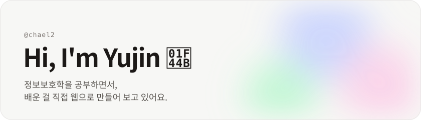

 
  

  
  

### About

- 🎓 중부대학교 **정보보호학전공**
- 🌱 지금은 **PSOC**를 만들고 있어요: 보안 시나리오로 진단부터 대응까지 직접 해 보는 학습용 시뮬레이터
- 📜 네트워크관리사 2급

### Projects

| | 프로젝트 | 한 줄 소개 |
| :-- | :-- | :-- |
| 🚧 | **PSOC** · 개인 | 시나리오 기반 취약점 진단 · 공격 탐지 · 사고 대응 시뮬레이터 |
| 🛡️ | [**SecureGuard**](https://github.com/chael2/SecureGuard) · 팀 · 2026-2 | 워게임으로 OWASP Top 10을 배우는 사이트 |
| 📚 | **Web-Pedia** · 팀 · 2026-1 | 웹 문법과 XSS · SQLi 개념을 정리한 학습 사이트 |

### Tech

보안 쪽으로는 OWASP Top 10, Suricata를 공부하고 있어요.
